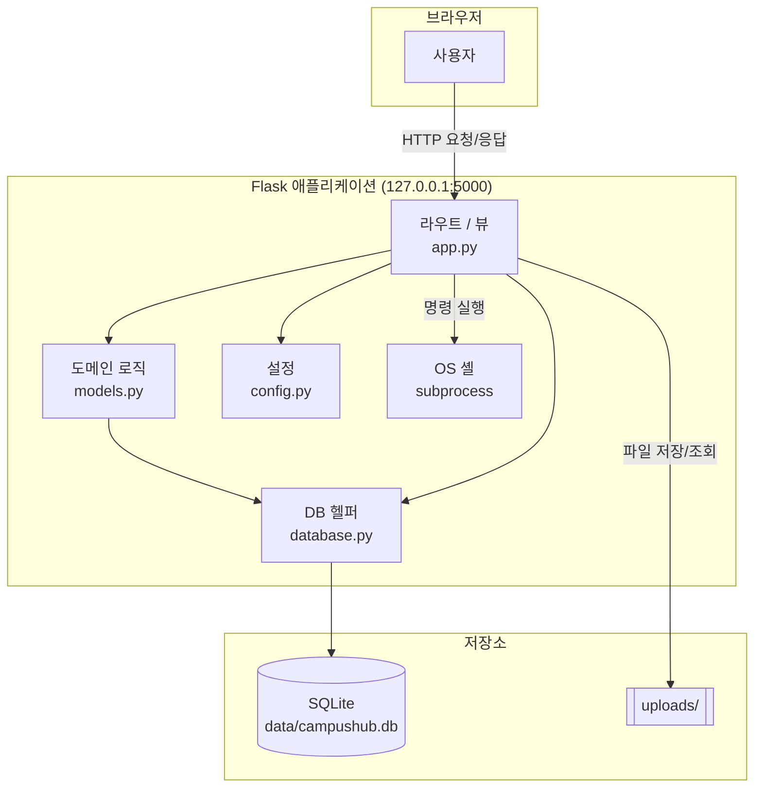
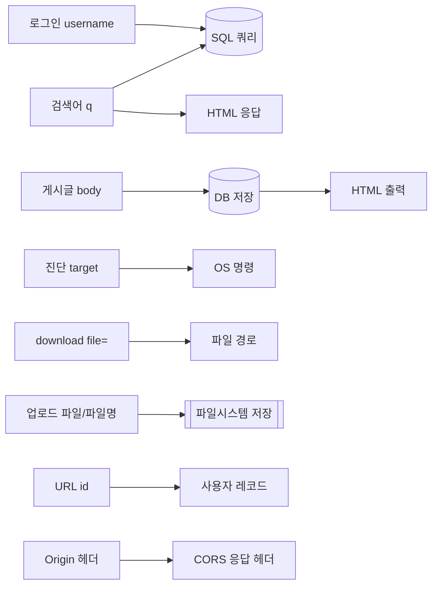
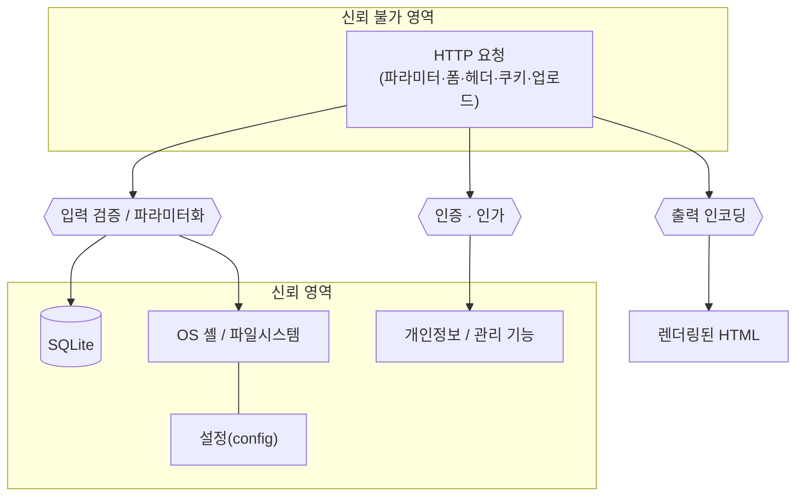

# CampusHub — Architecture

> 교육용 실습 환경. localhost 전용.

시스템 구조와 데이터 흐름을 파악하기 위한 참고 자료입니다.
`STUDENT_GUIDE.md` 의 분석 질문과 함께 활용하세요.

---

## 1. System Architecture

---

## 2. Data Flow (사용자 입력의 이동 경로)

사용자가 통제 가능한 입력이 시스템 내부 어디까지 이동하는지 보여줍니다.

---

## 3. Trust Boundary (신뢰 경계)

신뢰할 수 없는 입력이 신뢰 영역으로 넘어가는 경계입니다. 이 경계에서
어떤 검증이 이루어지는지(또는 이루어지지 않는지) 분석해 보세요.

---

## 4. Assets (보호 대상)

| 자산 | 설명 |
|------|------|
| 사용자 개인정보 | 이메일·학번·전화·이름 |
| 자격 증명 | 비밀번호 |
| 세션 | 로그인 상태 식별자 |
| 애플리케이션 설정 값 | 서버 구성/키 |
| 서버 무결성 | 서버에서의 동작 실행 |
| 서버 파일 | 소스/DB 파일 |
| 관리 기능 | 관리자 전용 동작 |

---

## 5. Entry Points (진입점)

| 유형 | Endpoint | 사용자 통제 입력 |
|------|----------|------------------|
| 페이지 | `/register`, `/login` | username, password, email … |
| 페이지 | `/search` | `q` |
| 페이지 | `/board/new`, `/post/<id>` | title, body |
| 페이지 | `/profile/edit` | email, full_name, department, bio |
| 페이지 | `/upload` | 업로드 파일 및 파일명 |
| 페이지 | `/admin`, `/admin/diagnostics` | 파라미터, 쿠키, target |
| 파일 | `/download?file=` | `file` |
| API | `/api/search?q=` | `q` |
| API | `/api/users/<id>` | `id` |
| API | `/api/posts` | (없음) |
| 공통 | 모든 요청 | 쿠키, 헤더 |
